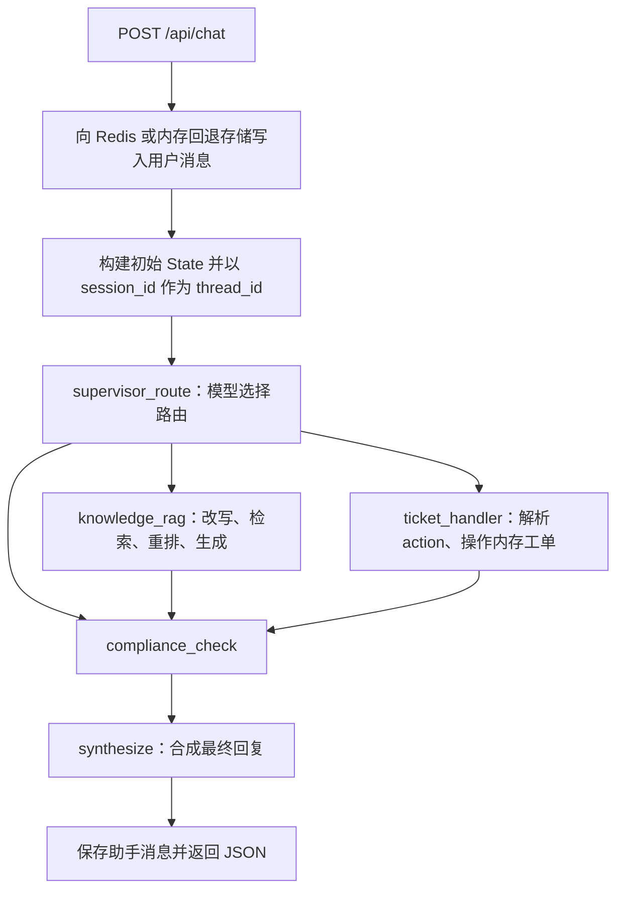
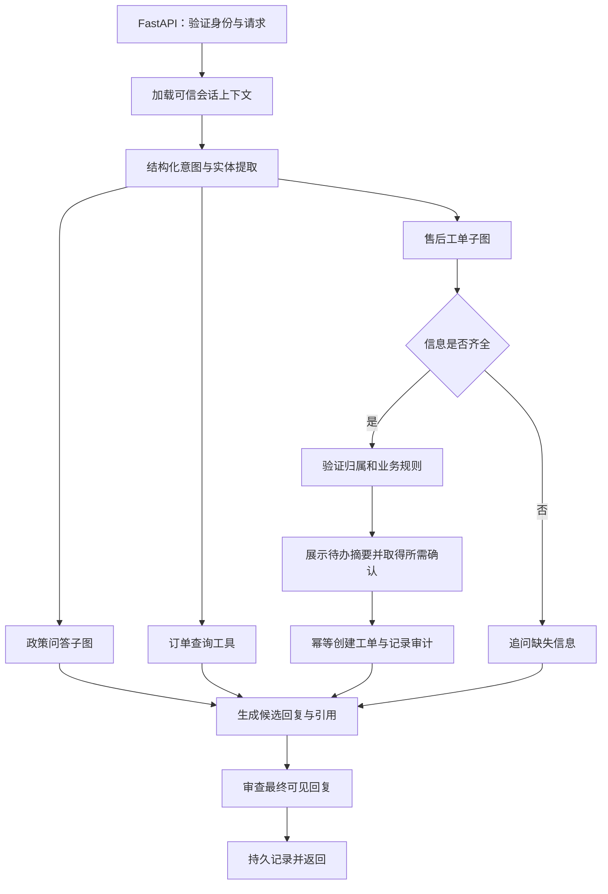

# Python 智能客服项目：源码审阅与工程学习路线

审阅日期：2026-11-05。对象：当前本地 `项目/smart_agent` 快照及上游 README；实现重点为 `python-impl`。Java、Go 仅作为仓库结构背景，不对其功能正确性下结论。

适用基础：熟悉 Python，学过 LangChain、LangGraph、RAG；MySQL、Redis、FastAPI 能运行简单示例，尚未完成完整业务工程。

本文中的“已确认”来自源码或无外部调用的离线复现；“建议”“验收目标”是后续工作，不表示项目已有这些能力。本次未取得真实模型调用、部署或压力测试结果。

## 1. 先建立对这个仓库的正确预期

这个仓库适合用作学习脚手架：有较完整的模块划分、流程示例和解释材料。不过，Python 当前实现距离 README 所描述的完整企业系统仍有明显差距，不能把 README 中每个功能和性能数字都当作已验证事实。

其中 `_simple_embedding` 和 `TicketStore` 的注释本来就注明了演示用途。阅读时要把作者的演示设计、文档目标、实际接线情况分开。

更适合你的目标是：参考原仓库，独立完成一个范围明确、可重复演示、结果可验证的“电商售后客服系统”。首先支持政策问答、订单查询、售后工单；金融业务和真实资金操作留到有明确业务要求之后。

判断一个简历项目是否属于你，主要看你能否解释和证明：发现了什么问题、为什么这样设计、实现了哪些改动、怎样验证有效、还有哪些边界。更换项目名和 Prompt 不能替代这些工作。

## 2. Python 代码实际怎样执行



这里是实际注册的节点关系。`IntentRouterAgent` 虽然被实例化，但它的 `classify/process` 没有接入该图；`MCPToolServer` 虽然在 API 层初始化，也没有接入两个业务节点的执行过程。

这可以称作“LLM 路由驱动的多节点客服工作流原型”。固定顺序的图节点不自动等于能自主选择和反复调用工具的 Agent。后续可以把知识问答和售后办理做成边界清晰的子图；并非每个节点都要调用模型。

阅读顺序如下：

| 顺序 | 文件                                         | 要回答的问题                                       |
| ---- | -------------------------------------------- | -------------------------------------------------- |
| 1    | `python-impl/api/main.py`                  | 请求和响应长什么样，session_id 从哪里来？          |
| 2    | `python-impl/agents/supervisor.py`         | State 有哪些字段，图怎样选择下一步？               |
| 3    | `python-impl/agents/knowledge_rag.py`      | 文档怎样检索，答案怎样生成？                       |
| 4    | `python-impl/agents/ticket_handler.py`     | 工单到底存在哪里，创建/查询如何分支？              |
| 5    | `python-impl/agents/compliance_checker.py` | 检查的是输入、操作还是回复，失败后怎样处理？       |
| 6    | `python-impl/memory/*.py`                  | 各层真正保存什么，哪些数据被读取来调用模型？       |
| 7    | `python-impl/mcp/mcp_server.py`            | 工具是否真正接到 Agent，是否可以被标准客户端调用？ |
| 8    | `python-impl/tracing/otel_config.py`       | 记录了哪些实际数据，指标在哪里更新？               |
| 9    | `docker-compose.yml`、`.env.example`     | 环境变量从哪里注入，究竟启动哪些服务？             |

## 3. 优先处理的源码问题

以下行号对应审阅时的源文件，后续修改后可能变化。

### 3.1 正常回复在最后一步可能直接抛异常：优先级 P0

证据：`agents/compliance_checker.py:205` 往 `sub_results` 加入 `compliance` 字典；`agents/supervisor.py:113` 收集所有非空值，随后在第 117 行执行字符串 `join`。

因此，即使生成答案和合规审查都成功，输入大致如下时也会失败：

```python
sub_results = {
    "knowledge_rag": "示例回答",
    "compliance": {"passed": True, "risk_level": "low"},
}
```

`join` 只能拼接字符串，无法直接拼接字典。离线完整 RAG 分支复现得到：

```text
TypeError: sequence item 1: expected str instance, dict found
```

临时修复可以只拼接允许输出的文本字段；更好的结构是分别定义 `candidate_answer`、`citations`、`review_result`、`ticket_result`，由最终节点明确读取。不要通过 `str(dict)` 把内部审查数据直接塞进客户回复。

学习点：Python 类型可以动态变化，但工程数据需要稳定结构。Pydantic 负责校验运行时数据，TypedDict 主要帮助描述代码中的数据形状。

### 3.2 当前向量不具备语义：优先级 P0

证据：`memory/long_term.py:66` 的 `_simple_embedding` 对整段文本算哈希，再以哈希作为随机种子生成向量。

“怎么退款”和“退款流程是什么”在语义上接近，哈希生成的随机向量却没有这种关系。FAISS 仍能返回数学上相近的向量，但不能据此认为检索到的是语义相关文档。

建议：接入真实中文/多语言 Embedding；文档和查询必须使用相同模型及相同预处理；维度从模型配置确定；更换模型或维度后重建索引。先保留 FAISS，证明流程和检索效果后再考虑 Milvus。

另外，当前索引是 `IndexFlatIP`，属于精确内积搜索；不能把代码中这一路径解释为“已经采用近似索引”。

学习点：向量库保存和搜索向量，Embedding 决定向量是否表达语义，两者各有职责。

### 3.3 审查结果解析失败会默认放行：优先级 P0

证据：`agents/compliance_checker.py:140` 附近，`json.loads` 失败时返回 `passed=True`；字段缺失也默认 `True`。离线输入非 JSON 审查结果，复现为 `passed=True, risk_level=low`。

建议：用明确的结构校验审查输出；解析失败标记为 `review_unavailable`，按业务风险选择重试、返回固定安全回复或转人工。对会影响真实业务的动作，不应把“没审出来”视为“通过”。只做格式约束仍不足以保证模型判断正确，需要规则和测试样例配合。

规则还有语境误判，例如“我们不保证收益”也含有禁词。应把关键词命中与违规结论分开评估，保留否定句、引用句和正常免责声明等负例。

### 3.4 查询/更新工单可能误建工单：优先级 P0

证据：`agents/ticket_handler.py:197` 只单独处理 `action == query` 且有 `ticket_id` 的情况，其余分支都调用 `create_ticket`。解析失败也默认构造 `action=create`。

离线输入 `{"action":"query"}`，结果创建了 1 张新工单。`update` 同样没有独立的执行分支。

建议：把动作定义为枚举，逐个分支处理：

- 创建：检查必要信息，展示摘要并按产品规则确认。
- 查询：缺编号时询问编号，或查询当前用户自己的最近工单。
- 更新：验证归属、允许的状态变化和版本。
- 无法判断：追问；不把未知输入自动变成写操作。

学习点：模型负责理解用户想做什么，业务代码负责决定信息是否足够、动作是否允许。

### 3.5 工单没有持久化，也没有重试去重：优先级 P1

证据：`TicketStore` 是进程内字典。进程重启后工单丢失；多个服务进程各有自己的字典。工具模块的 `ticket_create` 仅返回临时构造的工单信息，也没有保存。

建议：先接 MySQL。给 `request_id` 或幂等键建立数据库唯一约束，将一次业务操作和审计记录放在同一事务中。

“幂等”的直观例子：用户点两次发送、客户端超时重试，或图恢复时再次执行创建动作，都应找到同一次请求对应的工单，而不是再建一张。仅在 Redis 里加锁不能替代数据库最终的唯一约束和事务。

当前存在特别典型的组合风险：工单已在内存创建，最后合成回复却抛异常；用户看到 500 后重试，又创建一张。这比单独修一个报错更值得作为你的改造案例。

### 3.6 用户和会话没有可信的归属校验：优先级 P1

证据：`api/main.py:84` 接受请求者自行填写 `user_id`、`session_id`；历史查询接口直接按 session_id 返回数据。`TicketStore.query` 仅按工单号查询；工具调用 API 没有认证依赖。

建议：服务端从登录身份取得 user_id，所有会话、订单、工单查询都验证归属。不要让模型参数或请求体中的 user_id 成为可信身份。

“认证”是确认你是谁；“授权”是确认你能看哪些订单、改哪些工单。知道 session_id 或订单号不代表拥有访问权。用户 A 的操作不得因为换一个 ID 就影响用户 B。

## 4. 文档能力与代码接线之间的差距

| 文档中的能力         | Python 当前情况                                           | 后续怎样实现和验收                                            |
| -------------------- | --------------------------------------------------------- | ------------------------------------------------------------- |
| 多 Agent 编排        | 已有条件路由和固定节点关系；独立意图分类器未接入          | 统一使用一处结构化路由；记录业务意图、实体、缺失信息          |
| 并行调度             | 当前主图每次选择一条业务路径，没有 fan-out/fan-in         | 有独立任务时再并行；定义 reducer 和汇聚条件；用结果证明有收益 |
| Human-in-the-Loop    | 未实现 interrupt/resume；存在“已转人工”的回复模板       | 增加待审核记录、审批接口、持久检查点和恢复过程                |
| 真实 MCP 接入        | 自定义工具注册表和部分 JSON-RPC 风格分发；未接图          | 使用官方 SDK，完成初始化、传输、工具发现、调用和客户端联调    |
| 工具认证/Schema 校验 | `requires_auth` 只是字段；`input_schema` 没有执行校验 | 认证上下文、授权和运行时参数校验都要实际执行                  |
| 分层记忆             | 有工作字典、Redis 包装、FAISS 包装；接入和可靠性不足      | 明确每一层保存/读取什么，重启和失效后怎样恢复                 |
| SSE                  | 导入`StreamingResponse`，未提供 SSE 端点                | 区分进度事件和审查后的最终输出，增加取消和错误事件            |
| 全链路追踪           | 有节点装饰器 Span；缺请求根 Span 的接线                   | 连接 FastAPI 追踪、工具 Span、Token 统计和 request_id         |
| 指标接口             | `AgentMetrics` 有实现，但业务未调用 `record_call`     | 接上实际执行路径；多进程时不能把单进程 dict 当全局统计        |
| Milvus 切换          | 配置示例提及，Python 这里只有 FAISS 路径                  | 先写存储接口；真正接入并验证迁移，而非只改配置值              |

相关证据：`supervisor.py:173`、`:180`、`:203`；`api/main.py:147`、`:153`；`mcp_server.py:100`、`:140`；`otel_config.py:125`。

尤其注意：“回复里写已转人工”并不会创建人工任务。`supervisor.py:107` 的文案声称已转交人工且自动生成工单，但该分支没有对应的落库和审批操作。只有实际业务结果提供工单号、审核状态后，才能这样对用户表述。

## 5. 记忆系统应该怎样理解

| 组件            | 适合保存什么             | 示例                                            | 丢失后应该怎么办                 |
| --------------- | ------------------------ | ----------------------------------------------- | -------------------------------- |
| LangGraph State | 当前流程需要的结构化信息 | intent、order_id、pending_action、review_result | 由检查点或明确的恢复逻辑找回     |
| Checkpointer    | 一个 thread 的执行快照   | 流程停在等待批准的节点                          | 需要重启恢复时必须用持久存储     |
| MySQL           | 业务事实和持久记录       | 用户、订单、工单、聊天记录、操作审计            | 作为核心记录，需要备份和迁移策略 |
| Redis           | 可过期、可重建的数据     | 最近消息缓存、限流计数、短时锁                  | 根据用途重建或明确降级           |
| 向量索引        | 用于找相关资料的检索结构 | 政策文档块、说明书片段                          | 从原始文档和相同 Embedding 重建  |

知识库也不自动等于用户长期记忆：前者是业务资料，后者是用户偏好/历史事实，需要明确的写入条件、归属和纠错方式。订单“是否发货”“工单是否解决”应该查业务数据，不能以向量相似结果作为实时事实来源。

当前具体问题：

1. `create_supervisor_graph` 接收 `short_term_memory`，但没有使用它来为业务节点构造上下文；API 写 Redis 和历史接口读 Redis，并不意味着模型调用读取了 Redis 历史。
2. `MemorySaver` 配合相同 thread_id 可以在进程存活期间保留图消息；不能因此说项目完全没有多轮状态。但 RAG 和工单节点只读取最后一条消息，多轮追问的信息不一定被正确使用。
3. `MemorySaver`、`WorkingMemory`、内存工单都不能跨进程重启保持；工作记忆也没有请求结束清理，实际生命周期与注释不一致。
4. Redis 不可连接时会回退内存；回退没有 TTL，跨进程不共享，恢复后也没有自动合并。已建立连接之后的读写故障没有同样的处理。
5. `max_turns=20` 实际裁剪的是 20 条消息，通常只有约 10 轮完整问答，不是 20 轮。
6. RPUSH、LTRIM、EXPIRE 分三次请求执行；应明确原子性需求，使用事务或脚本组合，同时考虑一条会话的消息顺序。普通网络 pipeline 的批量发送本身不等于业务原子性。
7. 向量索引有 `save()`，当前 API 生命周期没有调用保存；每次启动会再次添加三个示例文档，持久化后还需要处理重复导入。

设计时不要把同一批历史消息从 MySQL/Redis 读取后，又和检查点里的完整历史重复追加。可以让 MySQL 保存持久聊天记录、检查点保存运行状态；每个新消息有稳定 message_id，请求图时只提交新消息，由 context builder 选出模型当前所需的有界上下文。

本地第一版审批流程可以用 SQLite 检查点学习持久恢复，但这不是多副本部署方案。后续选择与你固定版本兼容的共享持久后端，单独验证多 worker 的恢复和同会话并发策略。

## 6. RAG 改造怎样做才有意义

先限定知识范围，例如自建并注明为演示的退换货政策、运费说明、售后流程、质保条款。原项目仅启动加载三条金融/退款示例，无法证明通用客服检索能力。

建议按以下顺序递进：

1. 建立真实语义检索基线：文档 → 分块 → 真实 Embedding → FAISS → 生成回答。
2. 每个文档保留 document_id、version、source；每个块有 chunk_id，并保留属于哪个原始文档。
3. 明确文档生效时间和产品范围，避免引用过期或其他商品政策。
4. 回答返回独立的 citations 数组；引用 ID 必须来自本次检索结果，不能只相信模型自己写的文件名。
5. 没有依据时追问/拒答/转人工。相似分数的阈值需要基于具体模型和样例校准，不能把一个固定数字当作所有模型通用阈值。
6. 再比较 Query 改写、关键词/语义混合检索、rerank 的效果；保留真正有效的部分。

你之前主要用 DeepSeek 做聊天。聊天模型和 Embedding 模型可以来自不同供应商；不要默认一个兼容聊天接口的地址也支持 Embedding。把聊天模型、Embedding 模型及其地址/密钥分别配置，先验证所选模型真实可用。

当前 RAG 节点每次做改写、重排、生成，加上路由和回复审查，正常检索分支约有 5 次串行模型调用。这个次数可从代码和离线调用计数确认，不能据此推导真实耗时。短小且清晰的问题可以先做“不改写、不 rerank”的对照版本，测准确性、耗时和 Token 后再决定。

另外两项已复现的小问题：

- 分块函数注释说 512 tokens，实际用 `len` 计算字符；长句可以超过上限。600 字符的无标点段落得到 600 字符的块。
- rerank 返回的索引没有完整验证。请求 Top-3，输入 `-1,0,0,1,2` 实际能得到 5 个结果，还包含负索引和重复项。需要验证非负、范围、去重、最终截断。

Query 改写和生成当前都只收到最后一条问题；“那这个多久能退？”需要先结合会话中已经明确的商品或订单信息，不能指望单独改写这句话补全真实信息。

## 7. 你现在最应该补的工程知识

你已有的 LangGraph 知识可以直接用于 State、节点、条件边和子图。当前最需要补的是这些节点与真实业务系统的连接。

| 概念            | 用项目里的实际问题理解                                    |
| --------------- | --------------------------------------------------------- |
| API Schema      | `TicketCreate` 规定 HTTP 请求的字段、类型、长度和必填项 |
| ORM Model       | `Ticket` 描述 MySQL 表，ORM 把 Python 查询转换成 SQL    |
| Repository      | 集中写查表和更新代码，例如“查当前用户拥有的订单”        |
| Service         | 决定业务规则，例如“已关闭工单能否重开”                  |
| Tool            | 把经过约束的业务能力提供给 Agent；调用同一套 Service      |
| Agent/Graph     | 理解需求、收集信息、选择工具、安排流程                    |
| Connection pool | 应用启动时建立一批连接供请求复用，避免每次都新连数据库    |
| Transaction     | 创建工单和记录操作日志应一起成功，或一起失败              |
| Migration       | 表结构变化有版本记录，部署时按顺序更新                    |

建议先沿用你正在接触的 Tortoise ORM + MySQL，避免同时学习两套 ORM。Tortoise 和 FastAPI 的初始化/清理放在 `lifespan` 中；Redis 和模型客户端的资源管理也遵循明确的创建/释放边界。学习时按固定的依赖版本查文档，不要混用旧版示例。

第一条最重要的数据链路是：

```text
Postman 发 JSON
  → FastAPI 接收并用 Pydantic 校验
  → 从登录上下文确认用户
  → TicketService 检查业务规则
  → Repository 通过 Tortoise ORM 执行 SQL
  → MySQL 保存工单及操作记录
  → FastAPI 返回工单号和状态
```

先把这条链路用普通接口跑通，再让 Agent 调用相同的 Service。这样查到一个错误时，能分清是 HTTP、业务规则、数据库还是模型理解出了问题。

## 8. 建议的个人项目范围与结构

建议名称可以是“面向电商售后的可恢复多 Agent 客服系统”。业务范围先固定为：政策有依据地回答、订单按归属查询、售后申请追问补齐、确认后生成工单、查询工单进度。

普通工单不一定需要人工审批；是否由用户确认、是否自动创建应写成产品规则。真实退款执行和敏感信息修改属于另一类风险操作，可以作为后续沙箱审批示例。一定区分“申请工单创建成功”和“资金已退款成功”。

```text
python-impl/
  pyproject.toml
  uv.lock
  src/smart_cs/
    main.py
    core/             # 配置、日志、异常、认证
    api/              # HTTP 路由
    schemas/          # 输入/输出校验
    models/           # ORM 表模型
    repositories/     # 数据访问
    services/         # 业务规则和事务
    agents/           # 图、子图、提示词、上下文构建
    tools/            # Agent 调用的业务能力
    integrations/     # 模型、Redis、向量索引、MCP 适配
  tests/
  evals/
  scripts/            # 建库、导入文档、离线评估
```

这是逐步形成的目标结构，不需要先创建一堆空目录。随着创建工单、查询订单等实际功能出现再拆分。

原仓库把顶层包命名为 `mcp`，和官方 Python MCP SDK 的导入名相同。将项目代码放入自己的包名 `smart_cs` 并调整模块布局，能避免后续接 SDK 时出现本地模块遮蔽依赖的问题。

数据库可以逐步建立这些表：

| 表                    | 目的                 | 关键约束/索引                           |
| --------------------- | -------------------- | --------------------------------------- |
| users                 | 演示用户与身份       | 独立的用户 ID                           |
| sessions              | 一段会话属于谁       | user_id；按用户和更新时间查询           |
| messages              | 会话持久记录         | session_id、稳定 message_id、顺序字段   |
| orders                | 演示订单事实         | owner/user_id；订单号唯一               |
| tickets               | 售后工单和状态       | user_id、order_id；业务状态检查         |
| tool_executions       | 工具执行、去重和审计 | 可信用户 + 动作 + request_id 的唯一约束 |
| ticket_events（后续） | 状态变更历史         | ticket_id、操作者、前后状态、时间       |

业务账号只授予目标数据库所需权限。数据库密码用配置注入，应用不长期使用 MySQL root 账号。

## 9. 优化后的流程如何安排



这里有两个不同的控制点：执行工具之前验证权限和规则；返回内容之前检查回复。事后审查一句回复，不能撤销一个已经发生的写库操作。

如果加入真正的审批中断，必须实现持久检查点、审批接口权限、待审批记录以及 `Command(resume=...)` 恢复流程。恢复可能重执行节点前面的代码，副作用必须放在合适位置并以业务幂等保护。Checkpoint 不是跨数据库和外部系统的事务。

同一个 session 同时进来两条消息时，要选定顺序策略。第一版可按会话串行处理；之后再讨论共享锁/队列、超时和恢复。不同会话仍可以并发处理。

## 10. 按验收结果推进的六个里程碑

### 里程碑一：把参考代码变成可复现的基线

工作：独立 uv 项目与锁文件；统一 Settings；修复回复拼接；区分无效路由、解析失败和服务不可用；修正 README 接口地址。

当前 `MODEL_NAME` 虽写在配置示例中，图的默认初始化仍硬编码 `gpt-4o`。`VECTOR_STORE_TYPE` 也没有分派逻辑。Docker Compose 的 `${OPENAI_API_KEY}` 从其环境/指定 env 文件插值，并不因为编辑了 `python-impl/.env` 就自动获得相同值。要写出一条实际验证过的启动命令。

验收：新环境按文档能运行；`/api/chat` 返回稳定 Schema；配置不合法在启动时提示；未知输入不意外执行写操作。

### 里程碑二：先做 FastAPI + MySQL 普通业务接口

工作：建演示库和最少的表；实现创建工单、查工单、查订单；用 Service/Repository 管理规则和访问；配置连接池、清理和表结构迁移。

验收：Postman 创建工单后用数据库查询能看到；重启服务后仍能查询；缺字段返回明确错误；用户 A 不能读取用户 B 的工单；操作和审计能对应。

这一步是你当前最值得先完成的工程练习。

### 里程碑三：建立真正的 RAG 基线

工作：自建小型政策知识集、真实 Embedding、可重复导入、文档版本/引用、无依据处理。

验收：准备至少 20 条人工标注的检索问题；记录预期文档和实际 Top-k；政策外的问题不会被当作已有政策回答；更新文档后引用能追踪到版本。

### 里程碑四：让 Agent 调用已有业务能力

工作：连接结构化路由、RAG 子图、订单工具、工单子图；把订单号、申请原因等作为 State 字段；实现缺信息追问。

验收脚本：“我想申请售后”→ 追问订单 → 提供编号 → 查询归属与状态 → 补充原因 → 按规则确认 → 生成真实工单 → 用户再问进度时查到同一张工单。

不要用模型自己判断“这个订单属于用户 A”；由带身份过滤条件的业务查询给出可信结果。

### 里程碑五：补齐 Redis、恢复和业务可靠性

工作：MySQL 作为持久记录，Redis 做可重建上下文缓存；按会话处理并发；持久检查点；幂等执行；按业务需要加入审批。

验收：清除该会话缓存后可从持久数据恢复；重启后待办状态不丢；相同 request_id 重试只建一单；模拟执行成功但响应失败后重试，也返回原结果；Redis 不可用时表现符合预先声明的降级策略。

不要通过清空整个 Redis 来做实验；使用独立开发库或独立测试 key 前缀。

### 里程碑六：做可展示和可测量的工程交付

工作：评估集、回归测试、请求级追踪、关键错误日志、Python 专用 Compose；随后视需要加 SSE 和真实 MCP。

验收：有可复现的演示命令、测试数据、原始评估输出、失败案例和改进记录；模型响应耗时与业务耗时能分开看；一次失败可根据 request_id 找到对应节点和工具结果。

## 11. 最适合形成个人贡献的三个主题

### 主题 A：信息不全时的多轮售后办理

原型问题：节点只看最后一句，缺工单编号会误建工单。

你的实现：用结构化 `pending_action` 保存订单号、原因和确认状态；先补齐信息、查归属，再调用确定的业务动作。

证明：用固定的多轮脚本衡量信息完整率、错误写操作次数、完成任务需要的轮数；包含用户中途改订单号和取消的情况。

### 主题 B：可恢复且不重复执行的业务动作

原型问题：内存工单、内存检查点、回复阶段错误、客户端重试可能组合成重复创建。

你的实现：持久记录、唯一幂等键、事务、检查点恢复、真实审批记录。

证明：在创建前、创建后但返回前、审批等待中分别模拟中断；恢复后验证状态一致、只产生一条业务记录。

### 主题 C：有版本、有引用、能评估的政策 RAG

原型问题：随机向量、三个示例文档、只在提示词里要求引用。

你的实现：真实 Embedding、文档/块版本、检索过滤、引用校验、基线与改进版本对照。

证明：相同数据集上比较原始查询、改写、混合检索、rerank；报告召回、正确性、延迟和 Token，解释收益和代价。

完成两个主题并有证据，通常比在简历上列很多尚未接线的组件更容易深入讲清楚。

## 12. 怎样做评估，避免只有“感觉更好”

先手工维护一小批高质量样例，再扩大规模。建议最终为本项目准备约 60–100 条单轮及多轮测试案例；这是工作量建议，不是仓库已有数据。

案例覆盖：政策问答、订单查询、工单创建/查询/更新、缺信息、无依据问题、跨用户访问、注入指令、超时、重复请求、恢复。

| 指标                | 具体怎样算                                              | 注意事项                             |
| ------------------- | ------------------------------------------------------- | ------------------------------------ |
| 意图准确率          | 路由正确的样例数 / 标注样例数                           | 给出标签定义；多意图另行标注         |
| 文档召回率 Recall@k | Top-k 命中的相关文档数 / 标注相关文档总数，再按约定聚合 | 每题只有一篇相关文档时可另报 Hit@k   |
| 引用正确率          | 引用确实支持对应结论的比例                              | 引用存在与引用支持结论是两项不同检查 |
| 无依据处理          | 无答案样例中正确拒答/追问/转人工的比例                  | 同时报不该拒答却拒答的情况           |
| 任务成功率          | 正确完成所需业务结果的案例数 / 总案例数                 | 不能只看回复是否流畅                 |
| 权限隔离            | 越权案例是否被阻断                                      | 同时验证数据库没有错误写入           |
| 幂等与恢复          | 重复/恢复执行后的业务记录和状态                         | 响应成功不代表没有重复副作用         |
| 延迟和成本          | 端到端及各节点耗时、输入/输出 Token                     | 写清模型、并发、数据量、缓存条件     |

检索问题应有相关文档标注；端到端问题应有期望动作和禁止动作。开发集用于调 Prompt/参数，固定评估集用于比较，避免把同一批案例反复调到“满分”后当泛化效果。

可以从单 Agent + 同样工具/知识库做一个基线，再比较拆成多个子图是否改善任务成功率、权限可控性、成本或可调试性。不要预设 Agent 数量越多效果越好。

模型自报的 confidence 不是经过校准的真实正确概率；是否追问应结合标注案例和业务规则验证。LLM-as-judge 可以辅助，但不能成为所有正确性的唯一证明。

压测至少区分“固定假模型测试服务开销”和“真实供应商模型端到端测试”，否则很容易把无模型的 QPS 当作完整 Agent 吞吐量。小样本不宜对 P99 做强结论。

## 13. 离线复现记录

环境为现有项目 `.venv`；使用临时 Python 进程和 FakeLLM/FakeKB，不调用付费模型、不启动仓库 API、不连接业务数据库。17 个 Python 文件通过 AST 语法解析。以下检查不等于完整集成测试。

| 检查                                                       | 实际结果                                                                                                               |
| ---------------------------------------------------------- | ---------------------------------------------------------------------------------------------------------------------- |
| 主图节点                                                   | start、supervisor_route、knowledge_rag、ticket_handler、compliance_check、synthesize、end；没有独立 intent_router 节点 |
| 一次 RAG 分支                                              | 5 次 FakeLLM 调用后，在最终拼接出现 TypeError（字典不能 join）                                                         |
| 审查输出非 JSON                                            | 返回 passed=True、risk_level=low                                                                                       |
| 无业务回复而直接审查                                       | 返回 compliance_passed=True                                                                                            |
| 查询工单但缺 ticket_id                                     | 新建了 1 张工单                                                                                                        |
| requires_auth=True 的测试工具，无认证且参数类型不合 Schema | 执行成功，收到字符串而不是要求的整数                                                                                   |
| 长段落分块                                                 | 上限参数 512，实际出现 600 字符块                                                                                      |
| rerank 索引 -1,0,0,1,2，top_k=3                            | 返回 5 项，包含负索引选中的末项及重复项                                                                                |

检查时共享 `.venv` 中未发现 `redis` 和 `faiss` 模块。代码允许这些依赖缺失并回退，因此“程序能导入”不表示已连上 Redis 或执行真实向量检索。建议为正式项目建立独立 uv 环境和锁文件，再验证依赖。

本次只新增这份审阅文档；原业务代码没有按本文方案重构。后续实现与验证应形成独立提交记录。

## 14. 其余工程改进清单

- API 的 message 没有长度/空白约束；错误响应直接把内部异常内容返回给用户；需要公开错误码与内部日志分离。
- `/health` 永远报告 healthy，不能代表模型配置、数据库、Redis 都可用。区分存活检查和依赖就绪检查。
- 资源在模块导入时创建较多，`lifespan` 退出阶段没有关闭客户端/刷新追踪资源；将创建、连接校验、释放归到清晰的生命周期。
- `async def` 中的同步检索或文件操作仍可能占用事件循环；按实际耗时决定使用异步接口、线程或后台任务，不因函数写了 async 就认定没有阻塞。
- Redis、工作记忆和工具日志存在缺少全局容量/过期控制的路径；多进程实例间也不共享内存。
- 合规节点在原地修改 `sub_results`，其他节点也经常返回整个 State。顺序流程暂能运行，但未来并行写同一字段需要明确 reducer，不能认为不同 dict 子 key 就自动合并。
- 原始检索文档是数据，不应获得系统指令权限；权限和写操作约束必须独立于 Prompt。用恶意文档和用户输入做回归案例。
- SSE 如需最终回复审查，不应先把未经检查的内容全部推送给用户再决定拦截。可先发送检索/处理进度，完成检查后再发送可见答案。
- 默认 Compose 同时构建三种语言实现，不适合你的第一阶段。建立只含 Python + MySQL + Redis 的开发组合，追踪后端按需启用。
- Docker 的 `.env` 插值、挂载路径和命令行端口都需要按实际启动方式验证。原 README 示例用 `/chat`，代码实际接口是 `/api/chat`。
- 依赖只有宽松的最低版本，无独立锁文件；已有较新 LangChain 的学习环境可能与旧例子不同。先固定并测试一组版本，再有计划升级。
- 工具调用的结构化参数校验、认证和业务授权应在真正执行前完成；提供 `inputSchema` 描述不会自动执行验证。
- 用标准 MCP SDK 改造时完成客户端连通测试，避免只展示一段类似 JSON-RPC 的请求就宣称完整 MCP。当前代码也没有 Agent→MCP 的实际调用链。

## 15. 简历与项目讲解怎样写

原仓库 `docs/interview/resume-template.md` 中“日均 10 万咨询”“准确率 92%”“FCR 65%→82%”“成本降低 40%”等是模板中的叙述。当前扫描范围没有找到支撑这些数字的评估集、压测脚本、实验输出或真实部署记录，不能作为你的结果使用。

个人项目同样可以有扎实的量化证据：固定多少条案例、完成多少种异常场景、召回/正确性怎样变化、重复请求是否产生额外记录、哪些条件下成本更低。所有数字由自己跑出的结果填入，并注明演示/离线条件。

完成后可据实写成：

> 基于开源客服原型改造电商售后多 Agent 系统，使用 LangGraph 编排政策问答与工单办理子图；以 MySQL 持久化工单和操作审计，通过幂等键和检查点恢复处理重试；构建带文档版本和引用校验的 RAG，并在固定评估集上比较检索策略、任务完成率、延迟及 Token 消耗。

只有完成对应内容后才能使用这段描述；比较指标留给真实实验结果。保留原仓库 MIT 许可证，在 README 写清参考来源、原始能力和个人改动。面试重点讲清两到三个真实取舍和失败恢复案例。

## 16. 推荐的下一次具体任务

先完成“FastAPI + Tortoise ORM + MySQL 的工单创建/查询”这个独立业务闭环：

1. 为客服项目建立独立 uv 环境和配置，明确开发库与普通业务账号。
2. 写 `TicketCreate` 请求 Schema 和 `Ticket` ORM 模型。
3. 在 lifespan 初始化/释放 ORM 连接。
4. 实现 `POST /api/tickets` 和 `GET /api/tickets/{ticket_id}`。
5. Postman 创建后在 MySQL 查询记录；重启后验证记录仍在。
6. 加入归属校验、重复请求键和一条明确的状态流转规则。
7. 最后把这个 Service 包装成 Agent tool，再接回图。

这条顺序能把你已经会的模型/图知识和正在补的数据库、接口能力连接起来。

## 参考资料

- [上游仓库与 README](https://github.com/bcefghj/smart-cs-multi-agent)：用于核对项目定位和文档声明；功能判断以本地 Python 源码为准。
- [LangGraph：Workflows and agents](https://docs.langchain.com/oss/python/langgraph/workflows-agents)：区分固定工作流与动态 Agent。
- [LangGraph：Persistence](https://docs.langchain.com/oss/python/langgraph/persistence)：检查点和跨线程存储的职责。
- [LangGraph：Interrupts](https://docs.langchain.com/oss/python/langgraph/interrupts)：暂停、恢复与副作用幂等。
- [FastAPI：Lifespan](https://fastapi.tiangolo.com/advanced/events/)：数据库连接池等资源的启动与清理。
- [Tortoise ORM：FastAPI integration](https://tortoise.github.io/contrib/fastapi.html)：ORM 生命周期集成；以项目固定版本为准。
- [uv：Project structure and files](https://docs.astral.sh/uv/concepts/projects/layout/)：独立项目环境、项目元数据与锁文件。
- [Redis：Transactions](https://redis.io/docs/latest/develop/using-commands/transactions/)：多条 Redis 命令的执行边界。
- [MCP：Lifecycle（2025-06-18 规范）](https://modelcontextprotocol.io/specification/2025-06-18/basic/lifecycle)：初始化和能力协商。
- [MCP：Tools（2025-06-18 规范）](https://modelcontextprotocol.io/specification/2025-06-18/server/tools)：标准工具发现、调用及返回结构；具体实现选择与 SDK 匹配的协议版本。
