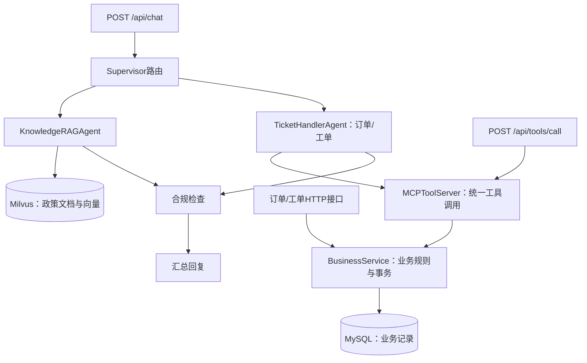

# 订单、工单接入MySQL：架构、修改说明与运行步骤

代码已经直接修改在当前 `python-impl` 项目中，不需要复制其他代码包。MySQL驱动和SQLAlchemy已通过uv记录到根项目的 `pyproject.toml`、`uv.lock`，驱动也已安装到共享 `.venv`。

**1. 当前架构如何衔接**



模型负责理解“查订单”“申请退款”“修改工单”等意图，程序依据允许的操作调用工具，业务服务执行参数化数据库查询和事务。模型不编写SQL、不直接操作数据库。

订单、工单HTTP接口和Agent工具共用同一个 `BusinessService`，所以通过Swagger创建的工单，也可以在聊天中查询；工具中创建的工单，也可以通过HTTP更新。没有第二套内存工单。

MySQL保存结构化业务数据；Milvus保存政策知识库；Redis继续保存聊天历史；LangGraph检查点仍为进程内存。它们承担不同职责。

保留现有Supervisor、RAG、业务、合规和汇总的图结构，将订单查询接入原 `ticket_handler` 节点。这个节点目前负责订单查询和工单办理，名称沿用原项目，避免为同一类业务增加重复流程。

这里沿用项目现有的工具注册、发现、调用和日志类，不代表本次接入了官方MCP SDK的远程协议服务。

**2. 修改了哪些文件**

| 文件 | 作用 |
|---|---|
| `business/schemas.py` | 订单、工单输入校验，状态枚举、金额和字段长度规范 |
| `business/database.py` | 连接池、Session工厂、四张业务表模型 |
| `business/service.py` | 唯一业务入口，负责读取、创建、更新和事务规则 |
| `mcp/business_tools.py` | 工具参数适配，调用真实业务服务与现有Milvus检索 |
| `mcp/mcp_server.py` | 删除默认假数据工具，改为注入共享服务；内部异常记日志 |
| `agents/ticket_handler.py` | 删除内存TicketStore；结构化提取意图后调用工具 |
| `agents/supervisor.py` | 订单/工单路由、工具服务注入、请求号传递、真实业务回执 |
| `api/business_routes.py` | 可独立验证数据库操作的订单/工单接口 |
| `api/main.py` | 启动时初始化MySQL和Milvus，注入依赖，关闭时释放连接池 |
| `init_database.py` | 显式初始化业务表，不调用模型、不录入假订单 |
| `check_business_mysql.py` | MySQL实机验收，写入带CHECK标识的测试数据 |
| `tests/test_business.py` | 临时数据库与完整调用链的自动化测试 |

配置方面更新了 `.env.example`、`requirements.txt`，并向当前 `.env` 追加缺少的MySQL配置项。模型密钥和已有Milvus配置未修改。

**3. 数据库中保存什么**

| 表 | 内容 | 关联 |
|---|---|---|
| `orders` | 订单号、用户、状态、总金额、版本、时间 | 一笔订单对应多件商品 |
| `order_items` | 商品名称、数量、单价 | 外键指向订单 |
| `tickets` | 工单号、用户、可选关联订单、类型、优先级、状态、描述、请求号、版本 | 可选外键指向订单 |
| `ticket_events` | 工单创建和更新时的状态变化、说明和时间 | 外键指向工单 |

金额使用DECIMAL，总额由商品数量和单价计算。订单与商品一次事务提交；工单与流转事件一次事务提交。失败会回滚，不会出现只保存半笔订单的情况。

同一用户的 `request_id` 唯一，重复提交相同内容会返回原工单；用同一个请求号提交不同内容会返回409。更新使用行锁及 `expected_version` 检查，拦截过期请求。每次操作在执行它的线程中创建独立Session，不跨线程共享Session。

**4. 首次运行：创建数据库和应用账号**

本机MySQL的3306端口在检查时可连接，但项目未提供可用数据库密码，尚未替你执行建库和实机写入。

在PowerShell登录MySQL；`-p`后不写密码，按提示输入root密码：

```powershell
mysql -h 127.0.0.1 -P 3306 -u root -p
```

电脑当前检测到的客户端路径也可以这样使用：

```powershell
& "D:\mysql-8.0.30-winx64\mysql-8.0.30-winx64\bin\mysql.exe" -h 127.0.0.1 -P 3306 -u root -p
```

出现 `mysql>` 后执行以下SQL。将密码占位文字换成你自己设置的应用密码，保留两边单引号：

```sql
CREATE DATABASE IF NOT EXISTS smart_cs
  CHARACTER SET utf8mb4 COLLATE utf8mb4_bin;

CREATE USER IF NOT EXISTS 'smart_cs_app'@'127.0.0.1'
  IDENTIFIED BY '这里替换为你的应用数据库密码';

GRANT SELECT, INSERT, UPDATE, CREATE, INDEX, REFERENCES
  ON smart_cs.* TO 'smart_cs_app'@'127.0.0.1';
```

这是创建项目应用账号，不是修改root账号。若 `smart_cs_app` 已存在，上述 `IF NOT EXISTS` 不会改变其密码；应使用原密码，或只针对这个应用账号执行 `ALTER USER`。当前接口没有删除操作，未授予删除权限。

**5. 填写项目自己的 `.env`**

文件：`D:\Python-Project\项目\smart_agent\python-impl\.env`。

以下项已经追加，只有密码需要你填成第4步的实际应用密码；如使用其他数据库或账号，也同步修改对应值：

```dotenv
MYSQL_HOST=127.0.0.1
MYSQL_PORT=3306
MYSQL_DATABASE=smart_cs
MYSQL_USER=smart_cs_app
MYSQL_PASSWORD="这里替换为你的应用数据库密码"
```

密码当前留空时，程序会明确提示缺少 `MYSQL_PASSWORD`，不会偷偷切回内存或返回假数据。DeepSeek、百炼和Milvus配置继续保留。

**6. 初始化并单独验证MySQL**

```powershell
cd "D:\Python-Project\项目\smart_agent\python-impl"
uv run --no-sync python init_database.py
```

预期输出：

```text
MySQL业务表已就绪：orders、order_items、tickets、ticket_events
```

初始化脚本只创建不存在的表，不删除数据、不插入示例订单。API启动时只检查表，不自动建库。以后修改表结构应使用显式迁移，重复运行 `create_all` 不会升级已有表字段。

然后执行：

```powershell
uv run --no-sync python check_business_mysql.py
```

该脚本不依赖DeepSeek、百炼或Milvus，会创建一笔 `ORD-CHECK-...` 订单和一张工单，验证实际MySQL中的查询、更新、四个并发相同请求的防重、旧版本拒绝，以及关闭连接池后重新读取。测试记录保留在数据库中，供你人工检查；不删除已有业务记录。

以后重新部署或恢复依赖时，可在根项目运行 `uv sync`。这次已经记录并安装了所需依赖，不必再运行pip安装另一份环境。

**7. 启动API并录入自己的订单数据**

```powershell
uv run --no-sync python -m api.main
```

打开 `http://127.0.0.1:8000/docs`，通过Try it out操作；也可以在Postman中使用raw JSON请求体。

POST `/api/orders`：

```json
{
  "order_id": "ORD-DEMO-1001",
  "user_id": "u001",
  "status": "paid",
  "items": [
    {"product_name": "机械键盘", "quantity": 1, "unit_price": "199.00"},
    {"product_name": "鼠标垫", "quantity": 2, "unit_price": "15.80"}
  ]
}
```

返回201，金额应为 `230.60`，版本为1。此后查询都读取这笔数据库记录。数据库初始为空时查询不到订单是正常情况，不会再根据任意订单号返回同一条假记录。

GET `/api/orders/ORD-DEMO-1001?user_id=u001` 应返回刚录入的订单。

PATCH `/api/orders/ORD-DEMO-1001`：

```json
{"user_id": "u001", "status": "shipped", "expected_version": 1}
```

再次GET，应看到状态为 `shipped`、版本为2。再次用版本1更新会返回409，要求重新查询。这里修改的是业务记录，并不代表已调用真实支付、库存或快递接口。

**8. 验证工单创建、查询、更新**

POST `/api/tickets`：

```json
{
  "user_id": "u001",
  "order_id": "ORD-DEMO-1001",
  "ticket_type": "refund",
  "priority": "medium",
  "summary": "键盘退款申请",
  "details": "键盘不合适，希望申请退款",
  "request_id": "ticket-demo-request-001"
}
```

返回真实 `TK-...` 工单号、`created` 状态、版本1。重复提交同一份JSON，工单号相同且 `replayed=true`，不会多建一张。

GET `/api/tickets/实际工单号?user_id=u001`。

PATCH `/api/tickets/实际工单号`：

```json
{"user_id": "u001", "status": "processing", "expected_version": 1}
```

再次GET，应看到 `processing`、版本2。也可以更新 `details`，该字段是替换后的完整描述，而不是自动追加的留言。

GET `/api/tickets/实际工单号/events?user_id=u001` 应看到创建和更新两条事件。

常见流转为 `created → processing → resolved → closed`。不允许从 `created` 直接跳到 `resolved`。完整流转表在 `business/service.py`，后续可按业务调整。

工单关联订单必须存在并属于同一用户。查询其他用户的工单或订单不会返回记录；但本地传入 `user_id` 仍不是登录认证。

**9. 验证聊天和工具入口使用同一数据库**

POST `/api/tools/call`：

```json
{
  "name": "order_query",
  "arguments": {"user_id": "u001", "order_id": "ORD-DEMO-1001"}
}
```

应返回 `success=true`，商品、金额和状态与你录入、更新的结果一致。

POST `/api/chat`：

```json
{
  "user_id": "u001",
  "session_id": "mysql-chat-demo",
  "request_id": "chat-order-query-001",
  "message": "帮我查询订单 ORD-DEMO-1001 的商品、金额和状态"
}
```

预期 `intent=ticket_handler`，回复来自真实订单查询结果。

再POST `/api/chat`：

```json
{
  "user_id": "u001",
  "session_id": "mysql-chat-demo",
  "request_id": "chat-create-ticket-001",
  "message": "我要为订单 ORD-DEMO-1001 创建退款工单，原因是键盘不合适"
}
```

现在聊天采用多轮任务：信息齐全后先返回待提交摘要，尚未写入工单。继续向同一会话发送“确认提交”，使用新的请求号，才会创建工单；随后GET `/api/tickets?user_id=u001` 可以看到记录。想更新时发送“把工单 实际工单号 改为处理中”，看到摘要后再确认提交。程序先查数据库取得版本，再更新，不让模型猜版本号。直接业务HTTP接口仍按明确请求立即执行。

`session_id` 标识多轮会话；`request_id` 标识单次请求。重试同一次创建时沿用请求号，新建其他工单时换新号。相同聊天重试时，如果模型提取出不同摘要，业务层会报告幂等冲突，不会再多建一张。

模型解析失败或返回空结果时只追问，不默认创建工单。GET `/api/metrics` 的 `tool_call_log` 可看到实际调用的订单和工单工具。完整的补充、修改、取消、Redis恢复及隔离机制见 [README.memory.md](README.memory.md)。

**10. 重启后验证持久化**

停止API再启动，重新GET原订单和工单，数据、状态和版本应保留。也可以在MySQL客户端查看：

```sql
USE smart_cs;
SELECT order_id, user_id, status, amount, version FROM orders;
SELECT order_id, product_name, quantity, unit_price FROM order_items;
SELECT ticket_id, user_id, order_id, status, version FROM tickets;
SELECT ticket_id, from_status, to_status, created_at FROM ticket_events ORDER BY id;
```

旧内存TicketStore中的工单没有自动迁移；旧进程结束后那些记录本来就丢失。Milvus文档仍保留在原向量数据库，不迁移到MySQL。

**11. 验证范围与当前边界**

自动化测试：

```powershell
uv run --no-sync python -m unittest discover -s tests -v
```

测试使用临时SQLite文件执行真实SQL，模型只用固定输出替身，不触碰用户MySQL、Milvus和外部模型。覆盖事务回滚、防重、归属条件、版本冲突、流转事件、重新连接后数据保留，以及HTTP → Graph → 工具 → 同一数据库链路。MySQL的认证、行锁和并发必须另外执行第6步验收。

合规节点审查业务操作后的回复，不是退款审批系统，不会撤销已提交事务。拦截回复时，程序依据真实回执说明已保存的工单号，避免声称操作未发生或编造“已转人工”。

当前实现业务记录存取和基本流转，尚未接入真实支付退款、物流、人工审批后台、登录和角色权限。新增管理接口用于本地学习和验证；正式对外开放前应从认证上下文取得用户身份，并为订单更新、工单流转增加角色授权。

常见错误：1045表示账号、密码或Host不匹配；1049表示数据库未创建；缺表先执行 `init_database.py`；422表示输入字段或状态不合法；409通常表示旧版本、重复订单号、非法流转或请求号复用。内部数据库错误记录在API终端，不直接把连接信息返回给调用方。
